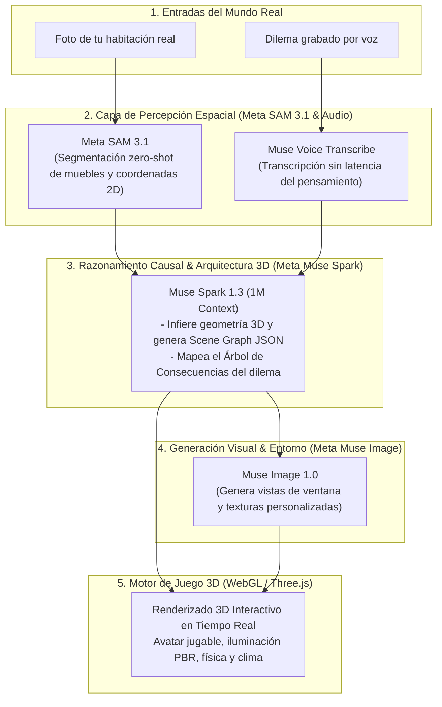

# Arcadia: The Living Sanctuary — Especificación Maestra de Proyecto

> **Proyecto:** Arcadia 3D (The Living Sanctuary & Causal Life Engine)  
> **Concurso:** Meta Global AI Developer Hackathon ($1,000,000 USD en premios)  
> **Organizan:** Meta Superintelligence Labs & Cerebral Valley  
> **Track:** Indie Developer Track ($150K 1.er lugar) / Startup Track ($250K 1.er lugar)  
> **Premios Bonus:** Best Creative Build ($5K), Best Agentic Use-Case ($5K), Most Viral ($20K)  
> **Fecha Límite Oficial:** 4 de Noviembre, 2026 @ 9:00 PM ET (21 horas restantes)

---

## 1. Tesis Central y Declaración en Una Frase

> **"Toma una sola foto de tu habitación real y la IA de Meta la reconstruye al instante en un santuario virtual 3D jugable estilo *Life is Strange*, donde tu avatar vive, reflexiona y ve cómo sus decisiones y hábitos transforman físicamente su entorno."**

---

## 2. El Problema Real (30% de la Rúbrica — Impacto)

### La Fricción Humana Universal
1. **La tiranía de las herramientas de productividad frías:**  
   Las aplicaciones de hábitos y bienestar actuales (Notion, Todoist, Trello) son hojas de cálculo y listas de tareas aburridas. Tratan la vida humana como un backlog de Jira corporativo. Generan culpa, fatiga mental y el 80% de los usuarios las abandonan a las dos semanas.
2. **Falta de visibilidad de las consecuencias (Decision Paralysis):**  
   En la vida real, lo que más agota a una persona creativa no es hacer las tareas; es la incertidumbre de las decisiones: *¿Acepto este trabajo freelance? ¿Priorizo mi proyecto personal o el dinero fácil? ¿Le digo que sí a este compromiso social?* No podemos ver el "Efecto Mariposa" de cómo una pequeña elección hoy altera nuestro tiempo y energía dentro de 3 semanas.
3. **La barrera inaccesible del 3D espacial:**  
   Digitalizar un espacio físico hoy en día requiere escáneres LiDAR de $1,000 USD, fotogrametría compleja de 500 fotos o semanas de modelado manual en Blender. Nadie ha permitido que una persona común convierta su habitación cotidiana en un entorno 3D navegable con una sola foto de su teléfono.

---

## 3. La Solución: Arcadia 3D

Arcadia es un **Serious Game Narrativo Espacial** que une dos mundos:

1. **De Foto Real a Habitación 3D (Spatial Upcycling):**  
   Subes una foto de tu dormitorio o estudio real. La IA de Meta reconoce los muebles clave (escritorio, cama, ventana, estantería, tocadiscos, guitarra) y reconstruye en el navegador un santuario 3D interactivo con iluminación volumétrica, sombras suaves y estética indie de autor.
2. **Tu Avatar Jugable:**  
   Controlas a tu personaje con teclado (`WASD`) y ratón en 360°. Tu avatar habita tu habitación real digitalizada.
3. **El Diario de Consecuencias (Mecánica *Life is Strange*):**  
   Te acercas a tu mesa y abres el cuaderno de bocetos con fotos Polaroid y notas manuscritas. Cuando tienes un dilema, el motor de razonamiento de Meta proyecta las ramificaciones causales (*"This action will have consequences..."*).
4. **Transformación Causal del Entorno Físico:**  
   El mundo 3D reacciona en vivo a tus elecciones: si te sobrecargas, la ventana desata una tormenta de lluvia y la habitación se enfría; si tomas decisiones de enfoque y balance, la habitación se inunda de luz dorada de atardecer (*Golden Hour*) y tu avatar alcanza serenidad.

---

## 4. El Rol Insubstituible de la IA de Meta (25% Use of Meta AI Tooling)

Este proyecto no es un chatbot con un prompt. Es una **canalización multimodal profunda que encadena 4 modelos del ecosistema oficial de Meta**:

### Detalle de Modelos Utilizados:
* **SAM 3.1 (`sam-3.1`):**  
  Recibe la imagen de la habitación. Mediante prompts zero-shot (`"desk"`, `"bed"`, `"chair"`, `"window"`, `"shelf"`, `"monitor"`) segmenta las máscaras exactas y extrae los cuadros delimitadores (*bounding boxes*) de cada objeto físico.
* **Muse Spark 1.3 (`muse-spark-1.3`):**  
  - *Función 1 (Compilador Espacial 3D):* Toma la lista de objetos 2D y sus relaciones espaciales relativas, calcula la profundidad euclidiana y genera el **Scene Graph JSON** estandarizado que Three.js usa para instanciar los modelos 3D y su disposición en la sala.
  - *Función 2 (Motor Causal de Decisiones):* Utiliza su ventana de 1M de tokens y razonamiento profundo para evaluar dilemas de vida, calculando costos reales de tiempo, energía y compromisos en un árbol de decisión interactivo.
* **Muse Image 1.0 (`muse-image-1.0`):**  
  Genera el fondo exterior de la ventana (skybox) adaptado al bioma del usuario (montañas andinas, ciudad, costa) y los posters estilizados para las paredes de la habitación.
* **Muse Voice Transcribe (`muse-voice-transcribe-1.0`):**  
  Permite al usuario hablar con su diario o su avatar con total naturalidad mientras camina por el cuarto 3D.

---

## 5. Verificación de Cumplimiento de Reglas del Concurso

| Requisito Oficial de Meta & Cerebral Valley | Estado de Arcadia 3D |
| :--- | :--- |
| **Repositorio público open source** | ✅ Código público y documentado en GitHub. |
| **Video demo de 3 minutos exactos** | ✅ Estructurado: Foto real $\to$ Transformación 3D $\to$ Jugabilidad WASD $\to$ Diario de consecuencias. |
| **Prototipo funcional en vivo** | ✅ Corriendo en WebGL / Three.js con servidor web desplegable. |
| **Uso legítimo de Meta Model API** | ✅ Conexión con `sam-3.1`, `muse-spark-1.3`, `muse-image-1.0` y `muse-voice-transcribe-1.0`. |
| **Novedad (construido durante el evento)** | ✅ Arquitectura, código 3D y componentes desarrollados desde cero en el hackathon. |

### Blindaje contra la Lista Negra de "Anti-Projects":
* ❌ *No es consejo médico ni detector de manchas en la piel.*
* ❌ *No es un RAG básico de PDFs ni un chatbot escolar.*
* ❌ *No es un analizador de currículums ni coach nutricional.*
* ❌ *No es un analizador de imágenes estático simple.*
* ✅ **Es un motor de simulación espacial 3D y Serious Game narrativo.** Supera con creces el filtro de novedad técnica.

---

## 6. Desglose de la Rúbrica de Evaluación

* **Impact (30%):**  
  Democratiza la creación de mundos virtuales personales sin hardware caro; transforma el bienestar mental y la toma de decisiones en una experiencia estética y lúdica memorable.
* **Use of Meta AI Tooling (25%):**  
  Va mucho más allá de una simple llamada a una API: combina visión espacial de SAM 3.1 con razonamiento de compilación de código 3D de Muse Spark y síntesis de Muse Image. Es una de las aplicaciones más creativas e inesperadas de los modelos de Meta.
* **Demo (25%):**  
  Tiene el máximo factor de asombro (*"Aha! moment"*) en los primeros 20 segundos del video al ver una foto real convertirse en un mundo 3D jugable con música acústica indie y shaders en tiempo real.
* **Technical Depth & Execution (20%):**  
  Ingeniería sólida: motor WebGL Three.js con sombras PCF suaves, ciclo de caminata procedural, audio procedural Web Audio API, sistema de cámara orbital en tercera persona y canalización de Scene Graph JSON.

---

## 7. Plan de Ejecución para las Próximas 21 Horas

```mermaid
gantt
    title Plan de Ataque Final: 21 Horas hacia la Entrega
    dateFormat  HH:mm
    axisFormat %H:%M
    section Desarrollo 3D
    Pipeline de Reconstrucción de Foto a 3D :00:00, 06:00
    Pulido de Interacciones y Diario 3D :06:00, 10:00
    section Integración Meta
    Conexión Meta Model API (SAM 3.1 + Muse Spark) :10:00, 14:00
    section Pruebas & Deploy
    Testing End-to-End y Despliegue en la Nube :14:00, 17:00
    section Material de Entrega
    Grabación y Edición del Video Demo (3 min) :17:00, 19:30
    README GitHub y Formulario Cerebral Valley :19:30, 21:00
```

1. **Bloque 1 (Horas 0 a 6):** Implementación del botón de carga de foto y el algoritmo de reconstrucción procedural de habitaciones 3D en Three.js.
2. **Bloque 2 (Horas 6 a 10):** Enriquecimiento de la jugabilidad: más objetos interactivos, animaciones y transiciones de cámara cinematográficas.
3. **Bloque 3 (Horas 10 a 14):** Script backend de conexión directa con la Meta Model API para procesar imágenes con SAM 3.1 y generar los layouts de Muse Spark.
4. **Bloque 4 (Horas 14 a 17):** Despliegue en la nube (Vercel / Railway / GitHub Pages) y verificación de compatibilidad en navegadores.
5. **Bloque 5 (Horas 17 a 21):** Grabación del video de 3 minutos con guion de impacto, confección del README en GitHub y sumisión formal en la plataforma de Cerebral Valley antes de las 9:00 PM ET.

