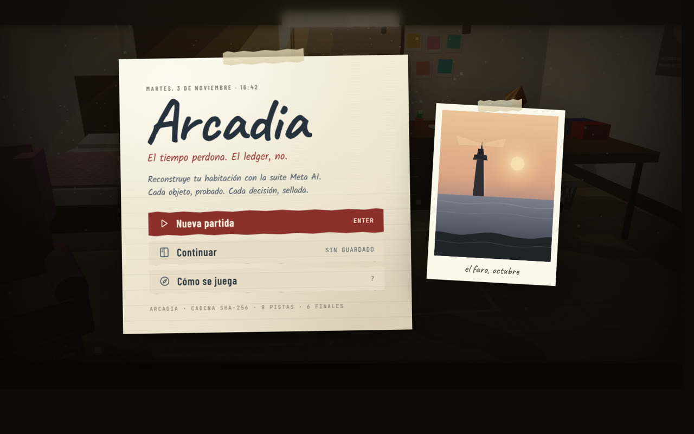
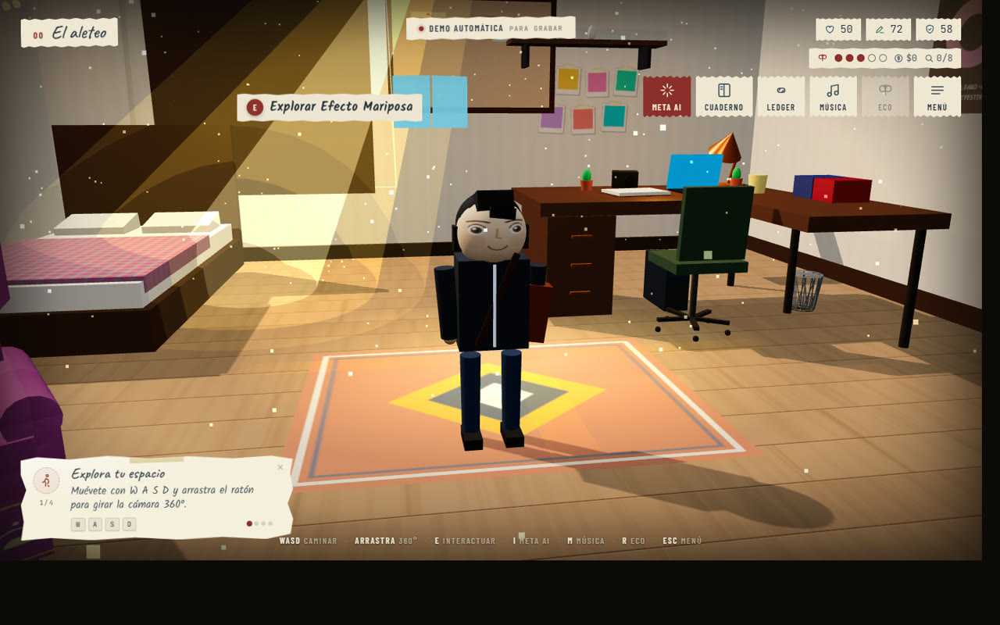
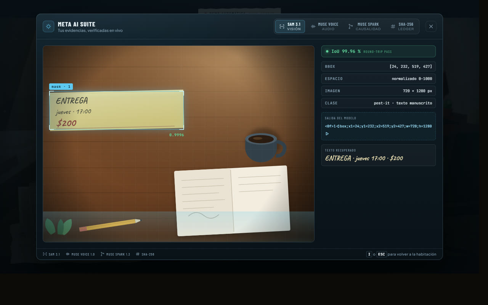
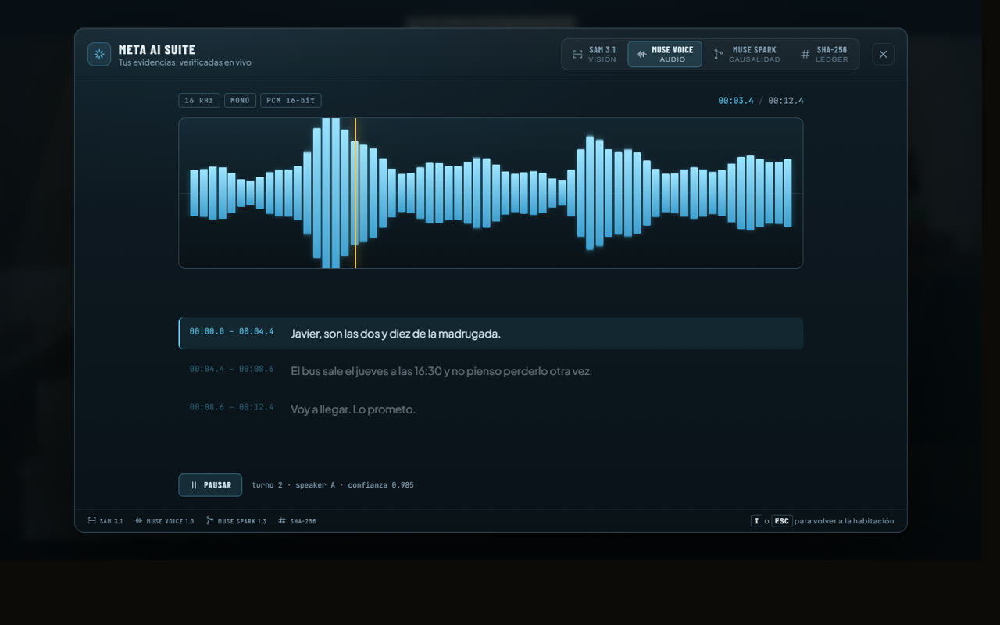
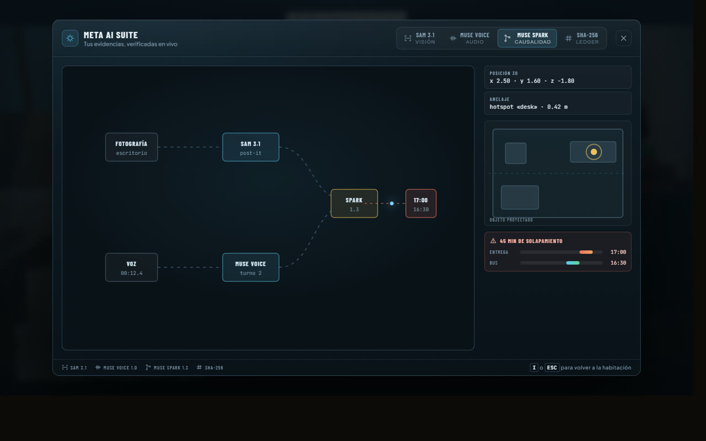
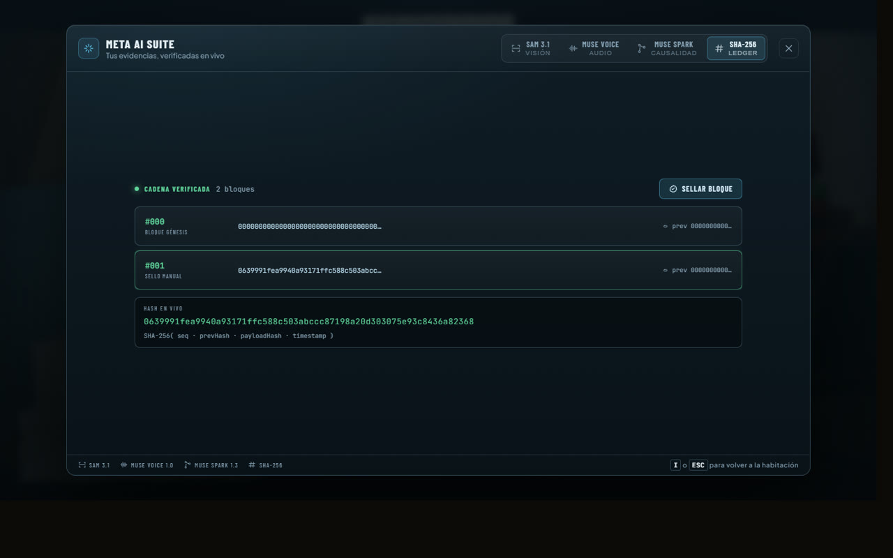
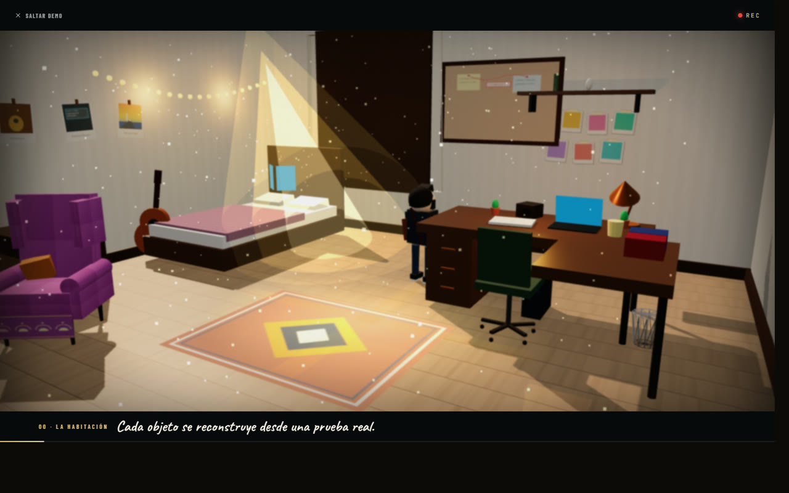

# Arcadia

**A room you can prove.**

Arcadia is a 3D sanctuary you walk through, and an append-only ledger of everything you find in it. Every object you reconstruct — a sticky note, a voice memo, a bus ticket — is segmented from the real photograph, transcribed from the real audio, anchored to a position in the room, and sealed into a SHA-256 chain you can rewind but never rewrite.

It is a game about memory, and a working provenance engine at the same time.



---

## Table of contents

- [What it is](#what-it-is)
- [Screenshots](#screenshots)
- [Playing it](#playing-it)
- [The Meta AI suite](#the-meta-ai-suite)
- [The ledger](#the-ledger)
- [Demo mode](#demo-mode)
- [Architecture](#architecture)
- [Getting started](#getting-started)
- [Testing](#testing)
- [License](#license)

---

## What it is

You are Javier. It is the week of a deadline, and your room is full of the evidence you have been avoiding: a note on the desk, a voice memo recorded at two in the morning, a ticket for a bus that leaves before you are supposed to deliver.

The room is not decoration. It is the interface. You walk to the desk, and the thing on the desk becomes a segmented object with a bounding box and an IoU score. You open the suite, and the same photograph is being read by a vision model while a waveform reads the audio beside it. You seal the finding, and a block is appended to a chain that will still be there after you have changed your mind.

Three things make it more than a demo:

**Nothing is fake.** The bounding box in the suite is the bounding box the parser returns. The hash is computed with `sha256Hex` from `src/domain/ledger.ts`, not written into the markup. The waveform's transcript is timed against the same playhead that draws the bars.

**Rewind is expensive.** You can undo a decision, but it costs an Eco charge, it never deletes the branch you abandoned, and it writes a `narrative.rewound` block. History keeps the scar.

**The interface is made of paper.** Torn edges, tape, ring binding, handwriting. No glass, no neon, no icon font, no emoji — every surface and every icon is drawn in code.

---

## Screenshots

### The room

You arrive with no text on screen. Four corner notes teach you to walk, to open the suite, to reconstruct an object, and to sit down.



### The Meta AI suite — SAM 3.1

A real segmentation pass: laser sweep, bounding box, confidence readout, and the model's token stream as it is produced.



### Muse Voice 1.0

The voice note, with a 64-band equaliser, a playhead, and a transcript that lights up line by line against the audio.



### Muse Spark 1.3

The causal graph that links a photograph and a voice to a single conflict, projected onto the floor plan of the room.



### The SHA-256 ledger

Blocks in a vertical chain, each one hashing the previous. Seal a finding and watch the digest settle from amber to green.



### Demo mode

One click, a 90-second take with letterbox, subtitles and a progress bar. Built so the recording can be made without a single human error.



---

## Playing it

### Controls

| Key | Action |
|---|---|
| `W A S D` / arrows | Walk |
| Mouse drag | Orbit the camera 360° (free look while seated) |
| `E` or click a hotspot | Interact |
| `I` | Open the Meta AI suite |
| `J` | Decision journal |
| `L` | Ledger inspector |
| `M` | Turntable |
| `R` | Rewind one decision (costs one Eco charge) |
| `V` | Toggle first / third person while seated |
| `Space` / `Enter` / click | Advance dialogue |
| `1–4`, `↑ ↓`, `Enter` | Choose a branch |
| `Esc` | Pause |

### The story

Five chapters — *El aleteo*, *La captura*, *La nota de voz*, *La encrucijada*, *Epílogo* — across 35 scenes, 8 collectible clues and 6 endings.

The conflict is small and specific: a delivery due at 17:00, a bus that leaves at 16:30, and 45 minutes that cannot be in two places. What you do about it is recorded, and the epilogue you get depends on what you were willing to lose.

### Systems that do something

| System | Behaviour |
|---|---|
| Progressive onboarding | Four beats driven by real engine signals — distance walked, suite opened, first clue sealed, posture changed. Never a timer. |
| Timed choices | Countdowns that auto-select the default branch if you hesitate. Keyboard or mouse. |
| Consequences | Five live stats (confianza, memoria, integridad, eco, dinero) plus flags feed the ending calculation. Weather shifts with the story. |
| Clues & Eco | 8 clues hidden in real 3D hotspots; each restores one Eco charge (max 5). No charges, no rewind. |
| Rewind | Restores the pre-choice snapshot, spends a charge, keeps the memory of the undone branch, and seals a `narrative.rewound` block. |
| First person | Sitting in the armchair or lying on the bed moves the camera to the eyes. Free head turn, `V` to step outside, `W` to stand up. |
| Save / continue | `localStorage` with compacted timeline snapshots, so saves never grow exponentially. |

---

## The Meta AI suite

Press `I` anywhere in the room. The suite deliberately breaks the paper metaphor — it is an instrument panel, dark and cool, with one electric accent per model. What is yours is paper; what the AI is doing to it is an instrument.

```
   photograph ──▶ SAM 3.1 ────────┐
                                  ├──▶ Muse Spark 1.3 ──▶ conflict ──▶ SHA-256 block
   voice note ──▶ Muse Voice 1.0 ─┘
```

| Model | Role | What you see |
|---|---|---|
| **SAM 3.1** | Pixel-level segmentation from a box prompt | Laser sweep, mask box `[24, 232, 519, 427]`, confidence, token stream, OCR result |
| **Muse Voice 1.0** | Turn-level transcription | Equaliser at 16 kHz mono PCM, playhead, timestamped transcript |
| **Muse Spark 1.3** | Cross-modal reasoning | Causal graph, 3D anchor position, floor-plan projection, overlap chart |
| **SHA-256 ledger** | Append-only provenance | Live digest, chain link to genesis, verification status |

The pipeline is real code, not a mock-up of one:

- **Coordinate round-trip.** A domain box survives encode → wire grammar → parse → decode without losing a row or a column. This is the check that catches half-open vs. inclusive off-by-one.
- **Audio contract.** Ten synthetic WAVs with known correct answers, through the real validator: stereo, 44.1 kHz, 8-bit, IEEE float, 11-minute and truncated files are refused locally before a paid round-trip.
- **Ledger invariants.** The chain verifies, a substituted evidence id is rejected on import, a planted one-hour overlap is detected exactly once, and bitemporal rewind sees both commitments before reconciliation.

Run them yourself with `npm run eval`. The report is written to `EVAL_RESULTS.md`, and its first paragraph states plainly what the harness does *not* measure: model quality. That requires real media and a Model API key.

---

## The ledger

Events are immutable. Nothing is ever updated in place.

```ts
ledger.append('narrative.decision', { ... })   // sealed, never edited
ledger.asOf(instant)                            // what was true at that moment
ledger.verify()                                 // recompute the whole chain
```

Each block hashes its sequence number, the previous block's hash, the payload hash and its timestamp. Change a byte anywhere in the middle and every downstream block stops verifying — which is exactly what `verify()` reports.

The narrative layer writes into the same chain as the multimodal evidence, through three strict Zod payloads in `src/domain/schema.ts`: `narrative.decision`, `narrative.clue`, `narrative.rewound`. The adapter is deliberately non-fatal: an optional audit write can never break a player's scene.

---

## Demo mode

The **Demo automática** chip in the top corner runs a 90-second scripted take:

```
0:00  dolly through the golden-hour room
0:12  Javier walks to the desk
0:21  SAM 3.1 scans the photograph
0:35  Muse Voice 1.0 reads the voice note
0:47  Muse Spark 1.3 draws the conflict
0:56  the block is sealed
1:06  Javier walks to the armchair and sits
1:14  first person, sunset, slow drift, end card
```

The sequence owns the camera, the avatar, the suite and its own subtitles, so there is no dead air and no human error. `Esc` aborts cleanly and hands control back. The recorded take ships as `arcadia-demo.mp4`.

---

## Architecture

The narrative layer is separate from the renderer. The Three.js engine was **not** rewritten: `src/main.js` publishes a late-bound capability table (`bus.api`) and emits interaction events; `src/game/*` consumes them. The renderer stays a renderer.

```
Myidea/
├── server/
│   ├── index.ts             # Secure Node proxy (isolates MODEL_API_KEY from the client)
│   └── policy.ts            # Local-only privacy gate, key resolution, error mapping
├── src/
│   ├── domain/
│   │   ├── schema.ts        # Pure Zod contracts (PixelBoundingBox, AudioTurn, DomainEvent)
│   │   └── ledger.ts        # Immutable EventLedger, SHA-256 chaining, Rewind asOf()
│   ├── services/
│   │   ├── metaAdapter.ts   # Multimodal adapter for Spark 1.3, SAM 3.1 and Muse Voice
│   │   ├── samParser.ts     # Official mask decode → source-pixel contours → domain box
│   │   ├── audioContract.ts # WAV/ASR contract enforced before any byte is uploaded
│   │   └── fixtures.ts      # Deterministic, self-contained SVG and turn fixtures
│   ├── game/
│   │   ├── bus.js           # Event bus and late-bound 3D capability table
│   │   ├── story.js         # Pure narrative graph: scenes, choices, rewind, endings
│   │   ├── game.js          # Runtime: HUD, dialogue, tutorial, saves, endings
│   │   ├── metaSuite.js     # The four-instrument Meta AI panel
│   │   ├── assistant.js     # Four-beat onboarding driven by engine signals
│   │   ├── demo.js          # The 90-second scripted take
│   │   ├── icons.js         # 66 hand-drawn SVG icons + procedural polaroid/spiral
│   │   └── portraits.js     # Procedural inline SVG portraits
│   └── main.js              # Three.js room, procedural audio, spatial timeline
├── scripts/
│   ├── eval.ts              # Conformance harness
│   ├── smoke.ts             # One live call per model
│   └── dev.mjs              # Vite UI + Node API proxy, concurrently
├── tests/                   # 132 tests across 7 suites
├── docs/screenshots/        # The images in this README
└── arcadia-demo.mp4         # The recorded take
```

**Stack:** Vite 6, Three.js 0.180, TypeScript 5.9 (strict, `erasableSyntaxOnly`), Node 22 with native type stripping, Zod 4, `@noble/hashes`.

**The pure core.** `src/game/story.js` is DOM-free, Three.js-free and fully deterministic, so the narrative graph can be unit-tested under plain Node. That is why 132 tests run in under a second.

---

## Getting started

### Requirements

- Node.js 22.6+ with native TypeScript type stripping (verified on v22.22.2 — earlier releases cannot execute the `.ts` test files)
- npm 10+

### Install and run

```bash
git clone https://github.com/reivaj-gg/arcadia-ledger.git
cd arcadia-ledger
npm install
cp .env.example .env
npm run dev
```

Open [http://localhost:3000/](http://localhost:3000/).

### Environment

- `MOCK_MODE=true` with an empty `MODEL_API_KEY` runs entirely on deterministic fixtures with zero network calls.
- `MOCK_MODE=false` requires a real key and is a boot error without one — never a silent downgrade to fixtures.
- The key is read by `server/index.ts` only, and must never carry a `VITE_` prefix, because Vite inlines those into the client bundle.
- Evidence marked `sensitivity: 'local-only'` is hard-blocked by adapter middleware and never leaves the machine.

### Build

```bash
npm run build      # production bundle in dist/
npm run preview    # serve the production build
```

---

## Testing

```bash
npm test           # 132/132 — narrative graph, ledger, adapters, parser, server
npx tsc --noEmit   # Node strips types without checking them; run both
npm run eval       # conformance harness → EVAL_RESULTS.md
```

| Suite | What it covers |
|---|---|
| `ledger.test.ts` | Hash chain, bitemporal rewind, tampering detection |
| `metaAdapter.test.ts` | WAV contract, SAM prompt grammar, key resolution |
| `samParser.test.ts` | Mask decode, contour tracing, simplification |
| `server.test.ts` | API proxy security, local-only privacy guard |
| `story.test.ts` | Narrative graph, grants, locks, rewind, save compaction, endings |
| `e2e.test.ts` | Full custody chain, end to end |

The production build is also verified in a real browser through a headless CDP harness: **25/25 checks, zero console errors**, including assertions that the HUD never overlaps itself, that no emoji reaches the rendered UI, and that no third-party character or franchise name appears on screen.

---

## License

MIT — see [LICENSE](LICENSE).
